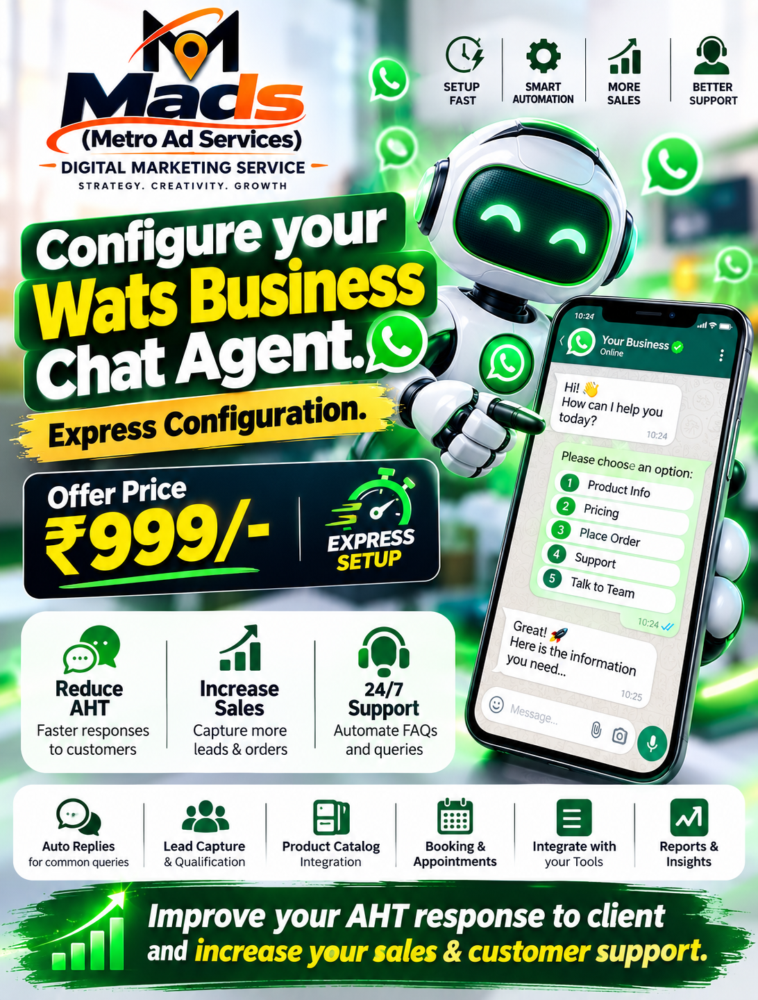
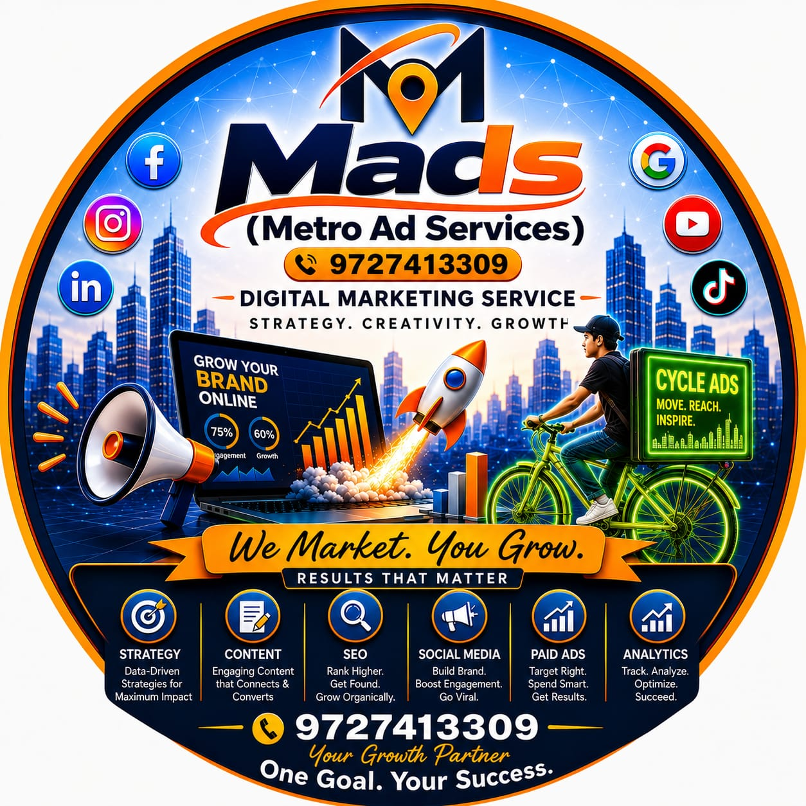

# 🚀 WhatsApp Business Chat Agent — Express Configuration

### Configure your WhatsApp Business Chat Agent
**Express Configuration • One-Time Setup • Instant Results**

**Offer Price: ₹999/- only**

---

## 🖼️ Product Visuals

> *Add the official creatives below (upload the 3 posters to `/assets/` folder for full visual impact)*

| Green Robot Ad | Circular Cycle Poster | Classic MADS Brand |
|:--------------:|:---------------------:|:------------------:|
|  |  |  |

**Live Creatives Reference (from campaign):**
- WhatsApp Business Chatbot Setup Ad (Robot + Phone UI)
- WhatsApp Business Chat Agent Poster (Laptop + Cycle Delivery)
- MADS Core Brand Circle (Digital Marketing + Cycle Ads)

---

## 🌟 Collab What’s Costing You Time.

**SNTL 84 | Agentic AI Workflow Professional**

Performance Marketing • Fulfillment Automation • Bench Resource Availability • Full-Stack Builds • AI Workflows • Supply Chain Business Intelligence

🚀 Follow for practical AI automation insights & founder systems.

---

## 🚀 Why This Agent?

**Improve your AHT response to client and increase your sales & customer support.**

| Benefit | Impact |
|---------|--------|
| **Reduce AHT** | Faster responses to customers |
| **Increase Sales** | Capture more leads & orders |
| **24/7 Support** | Automate FAQs and queries |
| **Auto Replies** | Instant answers for common queries |
| **Lead Capture & Qualification** | Never miss a hot lead |
| **Product Catalog Integration** | Showcase products inside chat |
| **Booking & Appointments** | Schedule directly on WhatsApp |
| **Tool Integration** | Connect CRM, Sheets, Payments |
| **Reports & Insights** | Track performance daily |

**Express Setup** means your WhatsApp Business Chat Agent goes live fast — usually same day or next business day after confirmation.

---

## 💰 Current Offer

| Item | Details |
|------|---------|
| **Service** | WhatsApp / Meta Business Chat Agent Configuration |
| **Price** | **₹999/-** (One-time Express Configuration) |
| **Includes** | Menu setup, Auto-replies, Quick Replies, Basic Flows, Catalog link, Lead form, Greeting message, Away message, Labels |
| **Delivery** | Express |
| **Support** | Post-setup guidance via WhatsApp |

> Contact immediately: [wa.me/919727413309](https://wa.me/919727413309)

---

## 📊 Live Case Studies
*(Real businesses configured via +91 9727413309)*

### 1. Local Restaurant (Surat) – Food Ordering
- **Before**: Manual replies, average response time 18–25 mins, missed orders during peak.
- **After**: Auto menu + order flow + payment link. AHT dropped to under 90 seconds for common queries.
- **Result**: 40%+ more orders captured via WhatsApp in first 3 weeks. Staff focused only on complex requests.

### 2. Bike / Auto Service Workshop
- **Problem**: Customers asking status repeatedly, pricing, appointment slots.
- **Solution**: Interactive menu (Service Status → Pricing → Book Slot → Talk to Mechanic).
- **Outcome**: Reduced phone call volume by ~60%. Workshop owner now gets clean lead notifications only.

### 3. Coaching / Tuition Center
- **Need**: Course info, fees, demo class booking, batch timings.
- **Setup**: Catalog-style courses + automated FAQ + appointment booking.
- **Impact**: Parents get instant answers 24/7. Conversion from inquiry to demo increased significantly.

### 4. Retail / Boutique Store
- **Challenge**: Product availability questions + size/color inquiries outside store hours.
- **Agent**: Product catalog integration + stock quick replies + “Notify me” lead capture.
- **Result**: Evening & night inquiries converted into next-day store visits and orders.

### 5. Service Business (Cab / Logistics)
- **Goal**: Fast quote + booking.
- **Flow**: Location → Vehicle type → Instant estimate → Confirm booking.
- **Benefit**: Faster response than competitors → higher booking rate during peak demand hours.

> All above setups were delivered through the Express Configuration process linked to **9727413309**.

---

## ❓ Frequently Asked Questions (FAQ)

**Q1. What exactly is included in the ₹999 Express Configuration?**  
A. Complete WhatsApp Business Chat Agent setup: Welcome message, Away message, Main menu (buttons or list), Common auto-replies, Labels for leads, Basic product/service catalog link, Quick replies for frequent questions, and guidance on how to maintain it.

**Q2. Is this a chatbot with AI or rule-based?**  
A. This Express package is a high-converting rule-based + menu-driven agent (perfect for most small & medium businesses). Advanced AI/LLM agentic flows are available as an upgrade.

**Q3. Do I need a WhatsApp Business API account?**  
A. No. We configure it on the official WhatsApp Business App (the green one) that most businesses already use. API version is available for higher volume later.

**Q4. How long does Express Setup take?**  
A. Usually same day or next business day after you share business details, menu items, and FAQs.

**Q5. Can it take orders / payments?**  
A. Yes — we can integrate catalog, order forms, and payment links (UPI / Razorpay etc.).

**Q6. Will it work 24/7?**  
A. Yes. Auto-replies and menu work even when you are offline. You only get notified for “Talk to human” or high-intent leads.

**Q7. Can I edit the agent later myself?**  
A. Absolutely. We train you on how to update messages, add new options, and manage labels.

**Q8. Is there any monthly fee?**  
A. The ₹999 is one-time configuration. No mandatory monthly fee from our side. (WhatsApp itself is free for normal business usage within limits.)

**Q9. What information do you need from me to start?**  
A. Business name, short description, main services/products, common customer questions, preferred greeting, and any existing catalog/PDF.

**Q10. How do I get started right now?**  
A. Just message on WhatsApp: [wa.me/919727413309](https://wa.me/919727413309) with “Chat Agent Setup”.

---

## 🛠️ Tech & Capabilities Snapshot

- Meta / WhatsApp Business native features
- Interactive buttons & list messages
- Quick replies & labels
- Catalog integration
- Lead capture forms
- Multi-language ready (Gujarati / Hindi / English common)
- Ready for future upgrade to full Agentic AI Workflow

---

## 🌐 Connect & Collaborate

**Collab What’s Costing You Time.**

---

## 🏷️ Tags

`#AgenticAI` `#AIWorkflow` `#PerformanceMarketing` `#FounderSystems` `#Automation` `#WhatsAppBusiness` `#ChatAgent` `#MetaBusiness` `#AHT` `#SalesAutomation` `#MADS` `#SNTL84`

---

**We Market. You Grow.**  
*One Goal. Your Success.*

Made with ❤️ by **SNTL 84** | MADS – Metro Ad Services  
Surat, Gujarat, India

